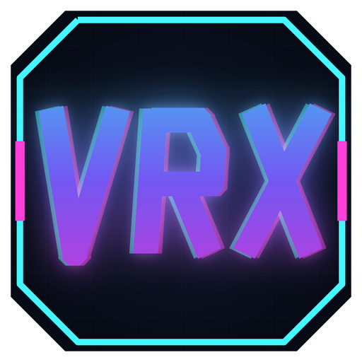
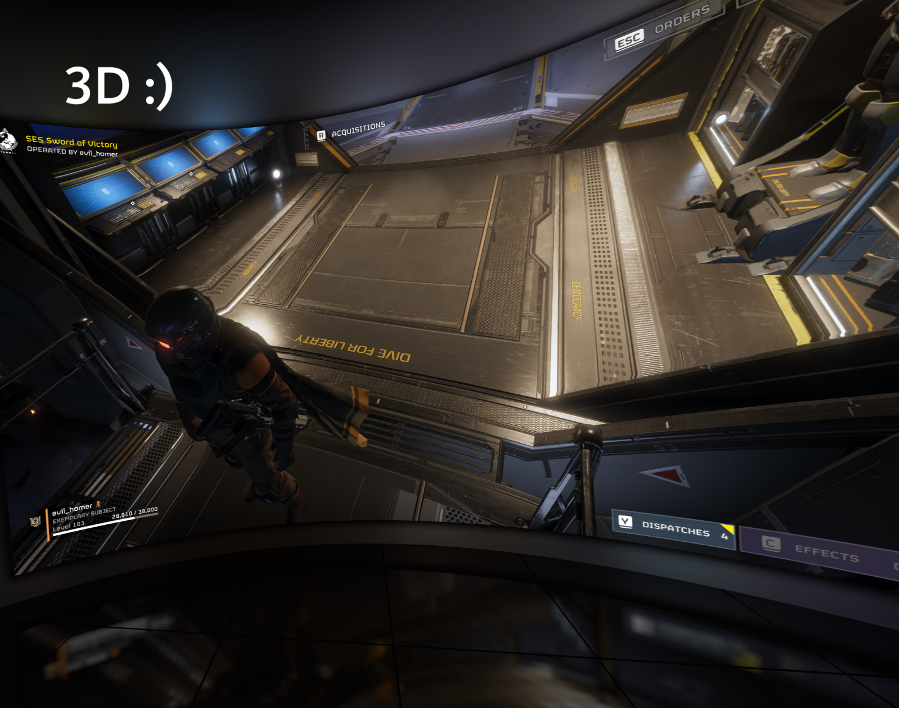
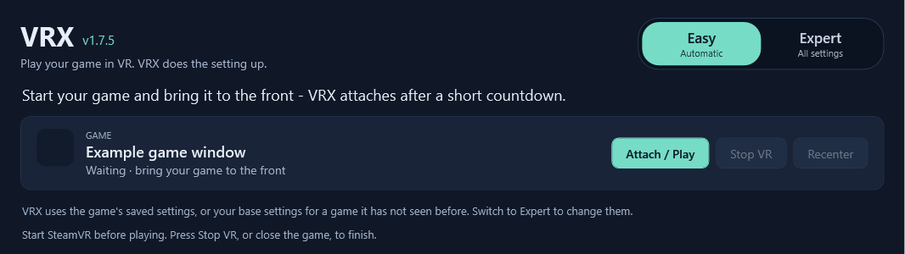

<p align="center"></p>

### [⬇ Download the latest release](https://github.com/pkellyuk/VRX/releases/latest)

**Website: [vrx3d.uk](https://vrx3d.uk)** · **[Get VRX3D on Steam](https://store.steampowered.com/app/5458290/)**

[](https://github.com/pkellyuk/VRX/releases/latest)

# VRX

Play flat PC games on a stereo screen in VR using your keyboard and mouse.
VRX captures the selected game window, estimates depth, and creates a stereo
view. All settings live in a desktop app; no in-headset UI or motion controllers
are needed.



**Easy mode:** start your game and bring it to the front; VRX counts down and attaches by
itself. Switch to **Expert** for every setting.



It is not only for games: attach to a browser window and 2D video you play in it —
YouTube, other video sites, your own files — becomes 3D on the same screen. Films and
series from protected streaming services, such as Netflix and Disney+, show as a black
picture: Windows blanks copy-protected video in every screen capture (the same reason a
screenshot of them is black), and VRX respects that.

VRX is free and open source. It is also on Steam as
[VRX3D](https://store.steampowered.com/app/5458290/): the same program, for anyone who
wants automatic updates or to support the project.

[](https://ko-fi.com/pkellyuk)

## Quick hints

### Optional motion-controller settings

The smaller **Controllers · Off / On** switch to the left of **Easy / Expert** enables
an in-headset settings panel. It is **off by default**, remembered app-wide, and works
in either desktop mode. Turning it on during playback opens the panel when VRX has XR
input focus. The controller's **Menu** button then shows or hides it. White beams from
either controller point at controls; squeeze the trigger to select or drag. Hold the
trigger on the title bar to pick up the panel: it hangs from the grabbed point,
swings under gravity as you move it, and turns when you twist your wrist. Release
to leave it at its current position and angle. Both sides remain readable. Move
the pointing controller's thumbstick up/down to scroll (twice the original speed).
Sections, option lists, a colour keypad and the Apply to all
confirmation stay inside the panel. Settings use the same profile, validation and live
updates as the desktop app.

The panel opens 1.2 metres ahead, centred where your headset is looking, including its
up/down angle. It then stays fixed until you drag it. Opening it again or recentering
places it in your current gaze direction.
If the screen follows your head, it stays still while the panel is open so that you can
look around without moving the game over the settings; following resumes when closed.

Touch-style controllers use left Menu. Steam Frame uses right Menu or left View.
Index and the generic profile do not expose an application Menu button, so they use
thumbstick click on either hand; their system/dashboard buttons remain with the runtime.
These are OpenXR actions: controllers
must be in **VR controller mode**, and SteamVR's dashboard can temporarily take their
input focus. After dismissing the dashboard, press Menu again. Controller bindings can
be remapped in the runtime. This feature controls VRX's settings; it does not forward
motion-controller input to the captured flat game. Steam Input/gamepad mode or a
separate gamepad/keyboard/mouse still controls the game.

Turning Controllers off hides the panel, cancels any drag and deactivates its actions.
Until first enabled, no controller actions, menu texture or desktop menu view are created.

Developer checks: `bench\native\openxr\test-controllers.bat` locates Visual Studio's C++
tools, tests placement/ray picking and compiles the full controller adapter without a
headset. `VRX.Desktop.exe --smoke-test` also checks settings persistence, bitmap IPC and
two-way slider/checkbox updates and writes controller-menu screenshots to `desktop/out`.
Hardware checks still require a headset: Menu press/hold, either-hand beams, title-bar
movement, dragging beyond a slider, thumbstick scrolling, focus/tracking loss, reopening/recentering and
turning the feature on/off during playback. Check both Easy and Expert, flat and curved
screens, and Steam Frame VR/gamepad mode switching.

### Everyday use

From using VRX day to day:

- **Run the game at 1080p.** It is much more stable, and in the headset you will
  not notice the difference.
- **Single GPU:** the fast **ZipDepth** model with **Game frame timing → Delayed
  to depth** and **Steady depth — motion vectors** gives the best experience.
- **Second GPU:** set it as the **Depth GPU**, turn on **Fuse with Depth Anything
  V2**, and keep **Delayed to depth** with **Steady depth — motion vectors**.
- **Steam games: turn off Desktop Game Theatre.** If you start a normal Steam game
  while SteamVR is running, SteamVR also shows it on its own flat screen in front of
  VRX's. In Steam, right-click the game → **Properties → General** and untick **Use
  Desktop Game Theatre while SteamVR is active**.
- **The screen is black in one eye** (seen on an Oculus Rift with an older Oculus
  app): set **Screen curve** to 1 % in Expert mode. The screen stays practically flat.

## Get started

Download VRX v1.8.1: the [installer](https://github.com/pkellyuk/VRX/releases/download/v1.8.1/VRX-Setup-1.8.1.exe)
or the [portable ZIP](https://github.com/pkellyuk/VRX/releases/download/v1.8.1/VRX-1.8.1-win-x64.zip)
([release notes and checksums](https://github.com/pkellyuk/VRX/releases/tag/v1.8.1); older versions on
[GitHub Releases](https://github.com/pkellyuk/VRX/releases)).
For the portable version, extract the entire ZIP and run `VRX.Desktop.exe`.
Keep the bundled folders alongside the application.

1. Start SteamVR and set it as the active OpenXR runtime.
2. Start your game.
3. Open VRX, select the game process and window, and click **Attach / Play**.
4. Adjust screen placement, size, and stereo strength on the desktop.
5. Use **Stop VR** to finish.

The screen stays fixed in the room by default. **Equals (=)** recenters it;
**F8** requests dismissal of the SteamVR dashboard. Both keys are configurable
and also reach the game. An optional head-follow mode is available.

Settings save per game executable under `%LOCALAPPDATA%\VRX\profiles`.
Session logs are under `%LOCALAPPDATA%\VRX\sessions`.

## Requirements and limitations

- Windows 10 2004 or later / Windows 11, a DirectX 12 GPU, and an active OpenXR runtime.
- Tested with Helldivers 2, an RTX 3090, PSVR2, and SteamVR. Other combinations need validation.
- The packaged release includes the desktop runtime, native dependencies, and both depth models.
- Depth is estimated by [ZipDepth](https://github.com/fabiotosi92/ZipDepth) by default: about 6x less GPU time per estimate than Depth Anything V2 Small (2.0 vs 13.1 ms on an RTX 3090), which keeps depth much closer to the game's frame rate. Untick **Fast depth model — ZipDepth** (per game, applies live) to use Depth Anything V2 instead. Fast motion and foreground edges can still distort.
- **Depth GPU** (per game, applies at Attach / Play) chooses which graphics card runs the depth model: the game's own GPU (default), any other GPU automatically, or a specific card from the list. Cards are remembered by name, and identical cards by their order, because Windows' GPU numbering can change after driver updates; if the chosen card is missing, VRX uses the game's GPU and the setting shows it as not found. With another card, the capture step makes a small model-size copy of each frame and the game GPU's copy engine sends it across, so depth no longer competes with the game. Measured with the RTX 3090 saturated by other work: ZipDepth 7.7 ms per estimate on an RTX 3060 (vs 19.9 ms on the busy 3090), Depth Anything V2 25.6 ms (vs 120.5 ms). Foreground crop passes still use the game GPU.
- **Steady depth — motion vectors** (per game, default on, applies live) reduces depth shimmer. Each new depth estimate is blended with the previous one, which the graphics card's hardware motion estimator (its video engine, not the shader cores) moves to where things are now, but only where that motion is verified, so fast pans and occlusions fall back to the new estimate. It adds CPU work to each depth pass, which the session log reports. See [XMMODEL.md](XMMODEL.md).
- **A still picture keeps its depth.** Windows 11 (24H2 and later) reports which parts of each captured frame changed. While less than 0.5% of the picture has changed since the last depth estimate — a blinking text cursor, the mouse, a clock on a still desktop — VRX keeps that depth for the new frame instead of estimating again, so the screen no longer twitches every time a small thing changes. Scrolling, video and games still get new depth for every frame. On older Windows every new frame gets new depth.
- **Unchanged parts hold their depth.** With steady depth on, wherever the picture has not changed since the last depth estimate, VRX keeps nine tenths of that depth instead of a half. A video in one window, typing or a game's HUD no longer makes the depth of everything else twitch, because the model's fresh guess for the parts that did not change is mostly ignored. Parts that change get new depth as before. See [XPOLISH.md](XPOLISH.md).
- **Flatten the left and right edges** (per game, applies live, off by default; about 4% suits desktop use) brings the depth smoothly to the screen's own distance over that share of the picture's width at each side, so both eyes see the same edges. With depth right at an edge, one eye sees a wider edge than the other (a full-screen browser's scrollbar doubled in one eye and cut in the other), which is tiring to look at. Anything inside the band looks flatter, which is why it is off unless you set it; 15% is the most. It needs the fixed screen. See [XPOLISH.md](XPOLISH.md).
- **Cut cleanly at depth edges across the picture** (per game, applies live, off by default). The picture can only be moved sideways for each eye, so at the top or bottom edge of anything nearer than what is behind it there are two ways to draw it. Turned on, the picture is cut at the edge, so what is next to it stays upright (desktop icons just above a window no longer lean); where the cut lands slightly off the real edge, a small fragment can move with the wrong side, such as a blob above a character's head. Off, there is no cut, but what lies next to the edge is slanted, opposite ways in the two eyes. **Cut only edges at least this deep** (12% of the depth range by default) limits the cut to stronger edges, and **Widen near objects up and down** (100% by default) sets how far a near object's depth is spread above and below it, which is where the slant lands. See [XPOLISH.md](XPOLISH.md).
- **Keep thin parts upright** (Experimental section; per game, applies live, off by default). A thin upright part of something, such as a spire on a roof, a mast or a post, is often missed by the depth model: it stays with the background while its foot is dragged along with what it stands on, so it bends opposite ways in the two eyes. Turned on, such parts are found in the picture and given the depth of what they stand on, so they move with it as one piece. It adds about 10 ms to each depth pass (the session log reports it). Tried on one scene so far: it may miss parts, flicker on moving pictures, or leave a slightly speckled patch beside a part. See [XPOLISH.md](XPOLISH.md).
- **Sharpen depth edges with the picture** (Experimental section; per game, applies live, off by default). The depth map is much coarser than the picture and its edges are soft, so the picture around an object's outline is moved by an in-between amount: slanted edges, halos, bits of background travelling with an object. Turned on, each pixel of the picture takes its depth from the nearby depth samples that look like it, every frame, so an object's depth ends where the object does. While on it replaces the widening of near objects and the clean cut. About half a millisecond of GPU time a frame at 1920x1080. Not yet judged in the headset: it may flicker along edges in noisy video. See [XPOLISH.md](XPOLISH.md).
- **Fill behind objects from a background layer** (Experimental section; per game, applies live, off by default). When a near object is moved sideways for an eye, a strip of what was behind it comes into view beside it, in that eye only. Normally the strip is filled row by row with the background next to it, mirrored. Turned on, the background behind near objects is made once for both eyes from the background on either side, and the strip shows that: the same hidden surface in both eyes, coherent from row to row, and soft where the picture had nothing. Best with sharpened depth edges. In stills it looks softer than the mirrored picture; whether it is easier on the eyes is for the headset to say. See [XPOLISH.md](XPOLISH.md).
- **Show depth map instead of game** (Experimental section; per game, applies live, off by default). A diagnostic: the depth used for 3D as a flat grayscale picture, white near and black far, after every depth setting above. Black when there is no usable depth.
- **Fuse with Depth Anything V2** (Experimental section; per game, default off, applies live, needs the fast depth model) runs Depth Anything V2 alongside ZipDepth. ZipDepth keeps depth fast; Depth Anything's more detailed layering is moved to the current frame with motion vectors, checked, and fitted onto ZipDepth region by region. It works best with another GPU as the depth GPU, and runs at most 10 times per second on one GPU. In the first headset test, fused and steadied depth together removed most of the "that looks wrong" moments. Offline: 59% closer to Depth Anything's layout than ZipDepth alone and 16% less flicker, or 36% less with steadying (XMMODEL.md).
- **Smooth depth steps (sub-pixel warp)** (per game, default on, applies live) removes depth banding. Whole-pixel stereo shifts give the entire scene only about 25 distinct depths at 1920 px wide, so a smoothly receding surface such as a field or a road is drawn as flat stripes with a 1 px step between them, which looks like ridges on uniform texture. Measured on a test field, the shift each row receives went from 25 flat bands with 1 px cliffs to 330 steps with a largest jump of 0.075 px. Turning it off restores the earlier warp, which is very slightly sharper. See [XBANDS.md](XBANDS.md).
- **Screen curve** (per game, applies live, 0% by default) wraps the screen around you like a curved television. A curved screen is drawn as a real cylinder for each eye from its tracked position, so its outline, perspective and the parallax when you move your head are all right; the top view in the desktop app draws the shape. 100% is a 70° wrap, further than any real screen (a curved monitor is about 40°): at the default screen (5.7 m wide at 3 m) the edges come 0.84 m nearer and reach 51° either side instead of 44°. SteamVR offers apps no cylinder layer, so VRX renders it; see [XCURVE.md](XCURVE.md).
- **Ambilight — glow around the screen** (per game, applies live, off by default) spreads the colours at the edge of the picture softly into the darkness around the screen, like the bias lighting behind a television: each point of the glow blends the whole border, the nearest part most, so it follows the local colour close in and softens further out. It rises from a thin dark bezel, fades out over 22% of the screen's width, wraps round a curved screen, and follows the scene smoothly rather than flickering. **Ambilight strength** sets its brightness. See [XCURVE.md](XCURVE.md).
- **World colour** (per game, applies live, black by default) colours the space around the screen: presets or any `#RRGGBB`. The ambilight glows over it.
- **Room — walls lit by the screen** (per game, applies live) puts you in a dark room whose walls, floor and ceiling are lit by the picture and the ambilight, like a television or a cinema screen in a dark room. The picture and the glow act as real area lights (a red edge on screen tints the nearby wall red), the glow lies on the wall behind the screen and wraps with a curved one, and the world colour becomes the room's house lights. The slider sets how pale the walls are; 30-60% looks like a cinema. The floor follows SteamVR's floor when it can, and the screen is kept level while the room is on. Needs the fixed screen. Below it, **Glass walls** turns the side walls, the back wall and the ceiling into glass in slim frames, looking out over a ground that runs to a horizon in the world colour; **Reflections** mirrors the screen, its glow and the room light in the glass and a polished floor, each eye tracing its own reflection; **Room light** adds a soft panel in the ceiling just above and behind you, and **Light colour** picks its colour from warm (2700 K) to daylight (6500 K). All four are per game, apply live, and need the room and the fixed screen. A new install starts with the room set up (Room 20%, Glass walls 14%, Reflections 15%, Room light 15%, warm white); games you had already set up keep their own settings. With glass or reflections on, the floor gets subtle 1 m tiles (continued as a 1 m grid on the ground outside), so you can count the screen's size in metres. Above them, **Environment** dresses the room as the **Open air at night** (a field under the stars, with hills on the horizon) or a **Lounge** (an oak floor with a rug, panelled walls with lamps, downlights), or seats you in a **Cinema with seats**: velvet curtains, black masking, a patterned carpet with step lights, sconces and tiered rows of seats round you, with a **Seat** choice (front row, middle, back row) that sets the screen's distance as in a real cinema (4.6, 7.5 and 11.4 m; the hall stays the same, so Width makes the screen look bigger or smaller from your seat) while the Distance slider rests; the room stays the default. Each is lit by the picture like the room; the room light becomes the sconces, lamps and downlights; glass and reflections are the room's own. See [XROOM.md](XROOM.md) and [XENV.md](XENV.md).
- **Make base settings** (button, next to Reset this profile) saves the settings currently shown as the starting point for games you have not set up yet, including the depth options, depth GPU and shortcut keys but not the game's own path or window. Games that already have a profile are unaffected, and **Reset this profile** returns to the base (or VRX's defaults when no base is saved).
- **Apply to all** (button, next to Make base settings) copies the settings shown to every game you have already set up, after an OK/Cancel warning. Each game keeps its own path and window; a profile that cannot be read is left untouched; games not set up yet still start from the base settings.
- **Easy and Expert** (the big switch at the top, remembered app-wide in `app-settings.json`). **Easy** is what a new install opens in: auto-attach is on, and the window shows just a one-line explanation, a card with the game in front or attached (its icon, name and state: waiting, attaching in N seconds, playing), Attach / Play, Stop VR, Recenter and the status line. In Easy the window shrinks to fit its content (a compact, fixed-size window); switching back to Expert restores its size and position (and maximized state). Both are remembered app-wide and brought back onto a monitor that still exists. The window uses VRX's own dark title bar (the skin, `desktop/VRX.Desktop/Skins/Vrx.xaml`) and still moves, snaps and resizes like any Windows window; click the logo or press Alt+Space for the window menu. Easy never changes settings: each game uses its saved profile, or the base settings for a new game. **Expert** shows every setting in collapsible sections — Game & window, Screen, Around the screen, Room, 3D & depth, Experimental, SteamVR & shortcuts, Profile and Session details — whose open/closed state is remembered; Screen, Around the screen and Room start open. Switching to Easy turns auto-attach on; switching back to Expert leaves it as it is. Anyone who used VRX before this switch existed (app settings, a saved game, base settings or a last-used game already there) opens in Expert, so nothing disappears.
- **Languages:** every text in the desktop app comes from `desktop/VRX.Desktop/Strings.resx` (English). To translate, copy it to `Strings.<culture>.resx` (for example `Strings.de.resx`), translate the values keeping each `{0}`-style placeholder, and rebuild; VRX follows the Windows display language and falls back to English. Numbers are shown in your regional format; profiles, app settings and the engine's control file stay culture-independent. `VRX.Desktop.exe --pseudo-locale` shows every string accented, about 35% longer and in brackets, to spot untranslated or clipped text. Engine logs stay English.
- **Auto-attach to the game in front** (checkbox in Expert's Game & window section, always on in Easy, off by default in Expert, app-wide in `app-settings.json`) counts down 3-30 seconds (5 by default) and then attaches to the window in front exactly as if you had picked it and pressed Attach / Play (its own profile, or the base settings for a new game). A window counts when it covers its whole monitor (full screen or borderless, not just a maximized window), or when its game has saved VRX settings and it is not a web browser. VRX, Steam, SteamVR, the Windows shell and terminals never count, and nothing happens while VRX itself is in front. The countdown shows in VRX's status and in a small click-through banner at the top of the game's screen that never takes the focus; switching to another window cancels it. After a session ends, or if attaching fails, that window is left alone until another window has been in front and you come back to it.
- **Choose…** (on the game card, in Easy and Expert) opens a chooser with a tile for every window VRX can play, most recently used first, each showing a live picture of the window (Windows' own thumbnails, as in Alt+Tab; a minimized window shows its icon), and a tile for each display. Clicking a tile plays it straight away, exactly as picking it in the lists and pressing Attach / Play. A display ("Whole screen", also listed last in Expert's game list) plays everything shown on it, such as the desktop or a video player, until you press Stop VR; its tile shows a snapshot taken as the chooser opens, and one set of settings is shared by all displays. The engine captures a display with `--monitor=N` (Windows' display order).
- **Show the desktop when you leave the game** (per game, SteamVR & shortcuts, on by default, applies at Attach / Play): while the game is not the window in front — after Ctrl+Esc, the Windows key or Alt+Tab — VR shows the display the game is on, and the game card says **Desktop**; back in the game, VR shows the game again. The engine (`--desktop-when-away`) checks the window in front ten times a second on its capture thread, ignores SteamVR and the Steam overlay, waits for a change to last 0.3 s (0.1 s back to the game), and moves its capture between the window and the display with a fresh depth history each time. If the game closes, VR carries on with the desktop until Stop VR; with the setting off, closing the game ends the session as before.
- **Game frame timing** (per game, applies live) chooses which game frame is shown with the depth. **Latest frame** (default) is smooth and immediate, but depth lags slightly behind moving things. **Delayed to depth** holds the game image back by the measured depth delay so the two line up, while motion stays at the capture rate. **Matched to depth** (the earlier frame matching) shows each depth estimate with the exact frame it came from: the best alignment, but the game only updates at the depth rate. Offline on four clips with depth 67 ms behind, against the latest frame: delayed cut depth mismatch from 0.050 to 0.016 and improved edge alignment from 0.59 to 0.72, with 26 game updates per second against matched's 15. Delayed and matched both add delay, so they suit slower games. See [XSYNC.md](XSYNC.md).
- **Extra foreground depth passes** are experimental (in the Experimental section with the other options still being tried out) and default on; their benefit varies.
- GPU contention can reduce depth update speed. A steady 60 depth updates per second is not guaranteed.
- SteamVR dashboard dismissal is best-effort. Releases are not code-signed, so on a new
  Windows 11 install Smart App Control can block the engine (see
  [Code signing and privacy](#code-signing-and-privacy)).

## Build locally

You need Visual Studio with the C++ tools and a Windows SDK (the newest one is found
with `vswhere`), the .NET 10 SDK, Python 3.12 and Git. The OpenXR loader and the HLSL
shader compiler VRX ships are pinned in `release/vendor`, so SteamVR is not needed to
build and every build compiles the same shaders.

From the repository root in PowerShell, fetch the pinned native packages
(`Microsoft.ML.OnnxRuntime.DirectML` 1.24.4 and `Microsoft.AI.DirectML` 1.15.4) into the
NuGet cache, and build the two depth models from their upstream sources. Model files are
not tracked in Git; `release/build-models.ps1` downloads the pinned sources, exports
`bench/models/model_fixed_686x392.onnx` (Depth Anything V2) and
`bench/models/zipdepth_faithful_fp16_672x384.onnx` (ZipDepth, the default) and checks
both against the SHA-256 of the released models. Then run each build step and confirm it
succeeds:

```powershell
dotnet restore release/NativePackages.csproj
./release/build-models.ps1
cmd /c "bench\native\openxr\build.bat --desktop"
$env:LIB = ''
dotnet build desktop/VRX.Desktop/VRX.Desktop.csproj -c Release
```

Launch `desktop/VRX.Desktop/bin/Release/net10.0-windows/VRX.Desktop.exe`.
The native renderer is `bench/native/openxr/out/xrplayer.exe`.
The local renderer enables a best-effort GPU-priority boost; its
`--normal-gpu-priority` command-line option disables the experiment for comparisons.

To package an installer and portable ZIP, install Inno Setup 6 and run
`./release/build-release.ps1`. Outputs go into a fresh folder under `release/out`.
Third-party notices and license texts are retained under `release` and bundled
with the release.

Releases are built by GitHub Actions ([`.github/workflows/release.yml`](.github/workflows/release.yml)),
which runs the same script in stages around code signing.

## Code signing and privacy

VRX releases are not code-signed. The free open-source signing from the
[SignPath Foundation](https://signpath.org) was declined for now (VRX does not have enough
users yet), so Windows 11's Smart App Control blocks VRX on PCs where it is turned on. The
release workflow is ready to sign once a certificate is available; the
[code signing policy](https://vrx3d.uk/code-signing.html) describes what would be signed
and how it is built.

VRX makes no network connections and collects no data: see the
[privacy policy](https://vrx3d.uk/privacy.html).

## License

Copyright (C) 2026 Paul Kelly.

VRX is free software licensed under the [GNU General Public License v3.0](LICENSE):
you may use, study, share and modify it, and anything you distribute that is built
from it must also be released under the GPL with its source available. It comes with
no warranty.

The released packages also contain third-party components under their own licenses
(the depth models, ONNX Runtime, DirectML, the OpenXR loader and the .NET runtime):
see `release/THIRD-PARTY-NOTICES.txt` and `release/licenses`.
